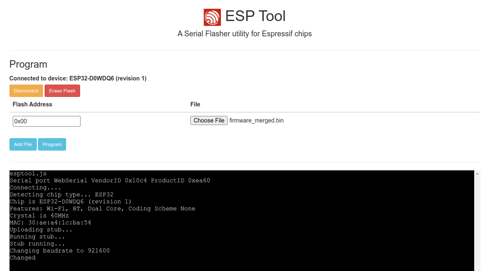
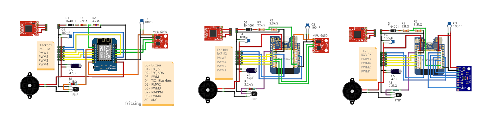

<div align="center">

# 🛩️ ESP-FC 飞控 · 耀坤整理版

**ESP32 高性能飞控 —— 迷你、低成本、高性能，为业余玩家而生**


**简体中文** · [**English**](README_EN.md)

</div>

---

> 📌 **本仓库是 [rtlopez/esp-fc](https://github.com/rtlopez/esp-fc) 的中文整理版。**  
> 固件源码 100% 保持上游原样（仅调整了目录位置，未改一行代码逻辑），  
> 本仓库额外提供：中文说明文档、重新规划的目录结构。  
> 上游项目与作者：[Ramon Lopez](https://github.com/rtlopez) · MIT 许可

## 📌 这是什么

ESP-FC 是一款运行在 **ESP32** 上的开源飞控固件，定位是**迷你、低成本、高性能**。

它的杀手锏是**兼容性**：固件刻意模拟了 **Betaflight 4.2** 的通信协议，  
所以你可以直接用官方 [Betaflight Configurator](https://github.com/betaflight/betaflight-configurator)  
图形界面来配置它，用官方 [Blackbox Log Viewer](https://blackbox.betaflight.com/) 分析黑匣子日志 ——  
**会玩 Betaflight 的人，零成本上手 ESP-FC。**

> ⚠️ 但请注意：它**不是** Betaflight。功能与性能上存在局限和差异，具体见下文。

## ✨ 核心特性

| 特性                | 说明                                                                 |
| ----------------- | ------------------------------------------------------------------ |
| **多芯片支持**         | ESP32 / ESP32-S3（推荐），另兼容 ESP32-S2 / C3 / RP2040 / RP2350 / ESP8266 |
| **全电调协议**         | PWM、Oneshot125/42、Multishot、Brushed、Dshot150/300/600 双向            |
| **全遥控协议**         | PPM、SBUS、IBUS、CRSF（含 ELRS）                                         |
| **ESP-NOW 接收机**   | 内置 ESP-NOW 接收 + Wi-Fi 配置，无需额外接收机硬件                                 |
| **多种陀螺仪**         | SPI / I2C 双总线，支持 MPU6050、MPU9250、ICM20602、ICM42688、BMI160          |
| **飞行模式**          | ACRO（手动）、ANGLE（自稳）、AIRMODE（空中解锁）                                   |
| **高循环频率**         | ESP32 + SPI 陀螺仪下，陀螺仪/主循环可达 **4 kHz**                               |
| **黑匣子记录**         | 支持 OpenLog / OpenLager / 内部 Flash                                  |
| **MSP + CLI**     | 标准 MSP 协议与命令行接口                                                    |
| **飞行中调参**         | PID 可在空中实时调整，不必落地重刷                                                |
| **安全保护**          | 失控保护（failsafe）、蜂鸣器、LED、电压监测                                        |
| **Betaflight 兼容** | 配置工具兼容 v10.10，现有 Betaflight 调参经验可直接套用                              |

## 📁 目录结构（本整理版重新整理）

> 🔧 **为什么要重整**：上游把 PlatformIO 工程文件、文档、测试、Python 辅助脚本平铺在根目录。  
> 本整理版把**固件相关的一律收进 `Firmware/`**，其中包含**完整的 PlatformIO 工程**  
> （`platformio.ini` 与 `src/`、`lib/`、`test/`、`bin/` 同级），  
> 因此**进入 `Firmware/` 后 `pio run` 即可直接编译，零配置改动**。

```text
esp-fc/                        # ← 仓库根：说明文档 + 许可证
├── README.md                  # 本文件（中文）
├── README_EN.md               # 英文版说明
├── LICENSE                    # MIT 许可（原作者）
├── AGENTS.md                  # AI 辅助开发约定
├── esp-fc.code-workspace      # VS Code 工作区（已指向 Firmware/）
├── Firmware/                  # ★ 固件工程（完整 PlatformIO 项目）
│   ├── platformio.ini         #   ★ 构建配置：7 种芯片环境 + native 单元测试
│   ├── partitions_4M_nota.csv  #   分区表
│   ├── src/                   #   主程序 main.cpp
│   ├── lib/                   #   核心库
│   │   ├── Espfc/             #     飞控主逻辑（控制律、传感器、无线）
│   │   ├── AHRS/              #     姿态解算
│   │   ├── EscDriver/         #     电调协议驱动
│   │   ├── Gps/               #     GPS 支持
│   │   ├── EspWire/           #     I2C 封装
│   │   ├── MultiButton/       #     按键处理
│   │   ├── betaflight/        #     Betaflight 协议兼容层
│   │   └── printf/            #     格式化输出
│   ├── include/               #   公共头文件
│   ├── test/                  #   单元测试（16 个测试集，native 环境运行）
│   ├── bin/                   #   构建辅助 Python 脚本（版本号、格式化、固件合并）
│   ├── docker/                #   测试容器
│   └── docker-compose.yml     #   容器编排
├── Docs/                      # ★ 文档
│   ├── setup.md               #   ★ 配置指南（必读）
│   ├── wiring.md              #   ★ 接线说明（必读）
│   ├── cli.md                 #   ★ CLI 命令参考（必读）
│   ├── wireless.md            #   ★ Wi-Fi 与 ESP-NOW 接收机（必读）
│   ├── connections.md         #   连接器定义
│   ├── development.md         #   开发指南
│   └── internal/              #   内部设计文档
└── .github/workflows/         # CI：单元测试 + 7 平台构建 + 产物上传
```

**整理前后对照：**

| 原始路径                                                                                                             | 整理后路径           | 理由                                  |
| ---------------------------------------------------------------------------------------------------------------- | --------------- | ----------------------------------- |
| `platformio.ini`、`src/`、`lib/`、`include/`、`test/`、`bin/`、`docker/`、`docker-compose.yml`、`partitions_4M_nota.csv` | `Firmware/` 下同级 | 合并为**一个完整 PlatformIO 工程**，内部相对路径零改动 |
| `docs/`                                                                                                          | `Docs/`         | 文档                                  |
| `LICENSE`、`AGENTS.md`、`esp-fc.code-workspace`                                                                    | 仓库根             | 项目级文件                               |

## 🚀 快速开始

### 硬件要求

- ESP32 或 ESP32-S3 开发板
- MPU9250（SPI）或 MPU6050（I2C）陀螺仪模块（GY-88 / GY-91 / GY-521 等）
- 带 5V BEC 的配电板（PDB）
- 蜂鸣器及若干元件（可选）

### 软件准备

- [Betaflight Configurator](https://github.com/betaflight/betaflight-configurator/releases) **v10.10**
- [CH340 USB 转串口驱动](https://sparks.gogo.co.nz/ch340.html)

### 从源码编译

```bash
git clone https://github.com/YaoKunS/esp-fc.git
cd esp-fc
git checkout yaokun-organized   # ★ 切到耀坤整理版分支（默认 master 是上游原版结构）
cd Firmware                     # ← PlatformIO 工程根

pio run -e esp32            # 编译 ESP32
pio run -e esp32s3          # 编译 ESP32-S3
pio test -e native          # 运行单元测试
```

> 💡 也可以用 VS Code 打开仓库根的 `esp-fc.code-workspace`（已配置好指向 `Firmware/`），  
> 配合 PlatformIO 插件一键编译烧录。

### 烧录固件

**方式一：下载预编译固件**

1. 从 [Releases 页面](https://github.com/rtlopez/esp-fc/releases) 下载对应固件
2. 打开 [ESP Tool Website](https://espressif.github.io/esptool-js/)
3. 点 "Connect" 选择设备端口
4. 添加固件文件，Flash Address 设为 `0x00`
5. 点 "Program"
6. 成功后断电重启



**方式二：PlatformIO 直接烧录**

```bash
cd Firmware
pio run -e esp32 --target upload
```

### 首次配置

烧录完成后，按顺序做四件事：

1. **配置引脚映射** —— 按你的实际接线设置各引脚功能，详见 [CLI 参考](Docs/cli.md)
2. **连接 Betaflight Configurator** —— 按个人偏好完成配置
3. **无桨测试电机** —— ⚠️ **务必拆掉桨叶再通电测试**
4. 玩得开心 😄

> [!NOTE]  
> **重要经验法则**：如果某个选项在 Betaflight Configurator 里改不动、保存后又回退，  
> 说明**固件不支持该功能**。请严格按 [配置指南](Docs/setup.md) 操作。

## 🔌 接线图



> ⚠️ **动手前必读**：接线错误是烧毁芯片最常见的原因。请先对照  
> [接线文档](Docs/wiring.md) 确认每根线，再通电。

## 📡 硬件与协议兼容性

### 主控芯片

| 芯片           | 状态                |
| ------------ | ----------------- |
| **ESP32**    | ✅ 推荐              |
| **ESP32-S3** | ✅ 推荐              |
| ESP32-S2     | ⚠️ 实验性            |
| ESP32-C3     | ⚠️ 实验性，性能不足，无 FPU |
| RP2350       | ⚠️ 实验性，部分可用       |
| RP2040       | ⚠️ 实验性，性能不足，无 FPU |
| ESP8266      | ❌ 已废弃，不再维护        |

### 传感器与协议

- **陀螺仪**：MPU6050、MPU6000、MPU6500、MPU9250、ICM20602、ICM42688、BMI160
- **气压计**：BMP180、BMP280、SPL06
- **磁罗盘**：HMC5883、QMC5883、AK8963、QMC5883P
- **接收机**：PPM、SBUS、IBUS、CRSF / ELRS
- **电调协议**：PWM、BRUSHED、ONESHOT125、ONESHOT42、MULTISHOT、DSHOT150、DSHOT300、DSHOT600
- **GPS**：M8、M9、F9、M10（双频，星座可通过 CLI 配置）
- **其它协议**：MSP、CLI、BLACKBOX、ESPNOW

## 📚 必读文档

> [!IMPORTANT]  
> 开始之前，**请先仔细阅读以下文档**。

| 文档                                      | 内容          |
| --------------------------------------- | ----------- |
| [配置指南](Docs/setup.md)                   | 完整配置流程，新手必读 |
| [接线说明](Docs/wiring.md)                  | 引脚定义与接线图    |
| [CLI 命令参考](Docs/cli.md)                 | 全部命令行指令与参数  |
| [Wi-Fi 与 ESP-NOW 接收机](Docs/wireless.md) | 无线连接配置      |

开发相关：[开发指南](Docs/development.md) · [内部设计](Docs/internal/)

遇到问题可加入上游 **[Discord 频道](https://discord.gg/jhyPPM5UEH)** 获取帮助。

## 🛠️ 开发环境

- Visual Studio Code
- [PlatformIO](https://platformio.org/install/ide?install=vscode) 插件
- Git

测试用 [Docker](https://www.docker.com/)：

```bash
cd Firmware
docker compose run --rm native     # 在容器内跑单元测试
```

## 📋 开发计划（上游 TODO）

- 定高
- GPS 导航
- MS5611 气压计
- 平衡车控制器

## 📜 开源协议与致谢

- **上游项目**：ESP-FC © [Ramon Lopez](https://github.com/rtlopez) ·  
  源码仓库 <https://github.com/rtlopez/esp-fc>
- **许可证**：**MIT License**（完整文本见 [LICENSE](LICENSE)，Copyright (c) 2016 rtlopez）
- **本整理版**：仅做中文文档与目录整理，**未修改固件逻辑**。
- **本仓库整理**：耀坤智联 YaoKunSmart · <https://github.com/YaoKunS>
- **B 站**：<https://space.bilibili.com/3707011699050767>

> ⚠️ 使用、修改、分发本项目时，请保留上游作者署名与 MIT 许可声明。  
> MIT 许可允许自由使用、修改、分发（含商业用途），但**必须保留版权声明与许可文本**。

## 🙏 赞助上游作者

如果你喜欢这个项目并希望它继续发展，可以支持一下原作者：

- BTC: `1Lopez7yPtbyjfLGe892JfheDFJMMt43tW`
- LTC: `LV3G3sJxz9AYpDMYUp8e1LCmerFYxVY3ak`

## ⚠️ 免责声明

本项目按"现状"提供，不附带任何担保。在自行焊接与通电前，请务必：

1. 核对 [接线文档](Docs/wiring.md)，确认电压极性与引脚定义
2. **首次通电务必拆掉桨叶**，避免电机意外转动造成人身伤害
3. 在空旷场地试飞，遵守当地无人机法规

⚠️ 因使用本项目造成的任何损坏、伤害或损失，作者与本整理方均不承担责任。**风险自负！**

---

<div align="center">

**🛩️ ESP-FC** · 由 [Ramon Lopez](https://github.com/rtlopez) 倾力打造 · MIT License  
· 本中文整理版由 [耀坤智联](https://github.com/YaoKunS) 维护

</div>
